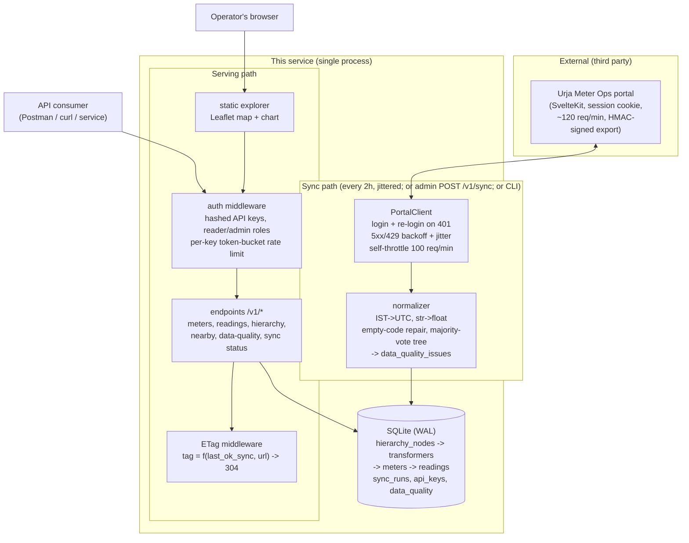
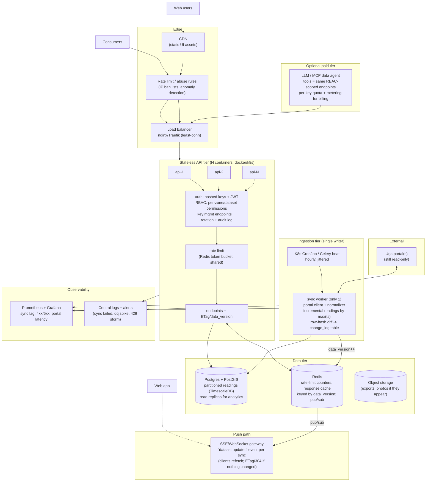

# Architecture

## 1. Current system (this submission, single process)

Everything runs in one Python process + one SQLite file. The sync job and the API server share the same binary.

Design properties:
- **Pull model**: portal is authoritative and read-only; everything flows portal -> DB -> consumers. Consumers never touch the portal.
- **Freshness**: data is as old as `SYNC_INTERVAL_HOURS` at worst; surfaced via `synced_at`, `/health`, `/v1/sync/status`. ETags change exactly when a sync lands - no cache to purge.
- **Failure behavior**: sync failure keeps old data (availability over freshness); per-meter failures are recorded, not fatal; overlapping syncs blocked by a lock.
- **Single point of everything**: one process, one file DB, in-memory rate limiter - deliberate for this scale (403 meters / 16k readings), and each breaking point is documented below.

## 2. Production version (if this became a real product)

Same data flow, horizontally scaled. What changes and why is in the README "Future scope" - this is that list drawn.

What each addition buys:
- **Postgres + partitioning** - survives concurrent writers + tens of millions of readings; PostGIS replaces the bounding-box/haversine scan.
- **Redis** - the rate limiter and the data_version counter must be shared once there's more than one API process; pub/sub turns "sync done" into a push event.
- **SSE/WebSocket** - solves "user looking at stale data": after each successful sync the worker bumps `data_version`, subscribers are told to refetch.
- **change_log** - sync diffs rows by hash so only real changes write + can be pushed/audited.
- **Single sync worker** - mirrors are cheap to read, expensive to write; keep one writer, scale readers.
- **WAF/IP rules** - the abuse detection that was consciously skipped: ban IPs with scraping-shaped traffic.
- **LLM tier** - paid natural-language access on top of the same endpoints; RBAC keeps it inside each customer's permissions; metering makes it billable.
